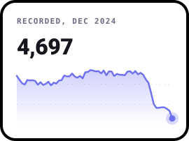
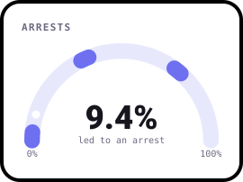
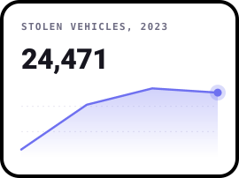
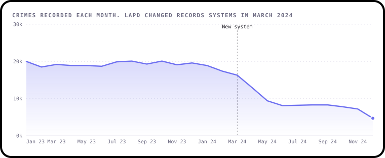
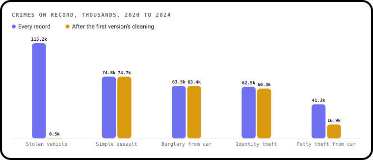
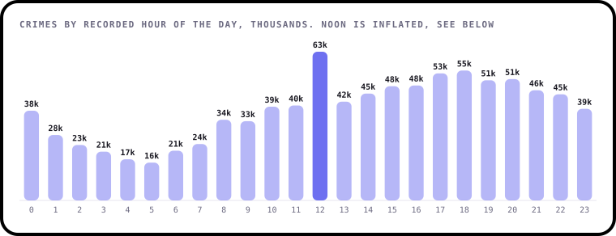
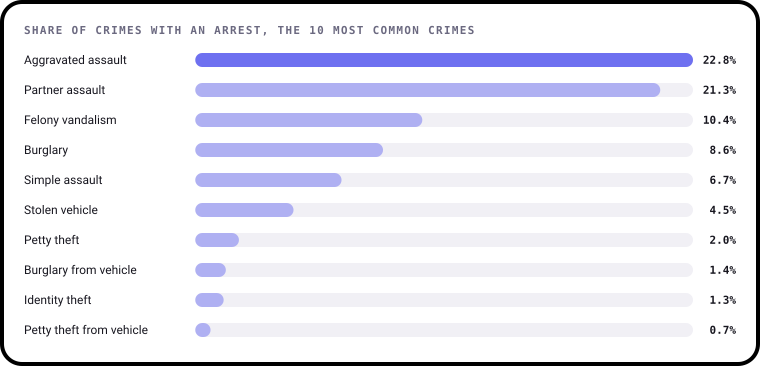

# Did Crime in LA Really Fall?

**An analysis of 1,004,894 crime reports from Los Angeles, 2020 to 2024: what they show, and the traps that make them say things that aren't true.**

[](https://github.com/ShazMoghaddam/Crime-Data-Analysis-Project/actions/workflows/checks.yml)
[](https://pypi.org/project/bezel-charts/)
[](LICENSE)

Plot this data by year and it looks like crime in Los Angeles collapsed in 2024. It's one of many things in this dataset that aren't what
they seem. This project separates what the data can show from what's an artefact of how it was recorded and cleaned.

<p align="center">
  
  
  
</p>

> **Every chart here is drawn with [bezel-charts](https://pypi.org/project/bezel-charts/), an open-source Python library
> created by Shaz Moghaddam, the author of this project.** It turns pandas data into clean, self-contained SVG charts.

---

## Key findings

<!-- key-findings:start -->
### The 73% fall that isn't one

Recorded crimes dropped from 17,394 in February 2024 to **4,697** in December. LAPD changed records systems on 7 March 2024, and
this dataset stopped being complete. It can't tell you whether crime fell.



### Cleaning deleted the most common crime

Stolen vehicles are the most common crime on record, with 115,184 reports. Dropping rows with blank fields, a common cleaning
step, left **546**, because those reports have no victim details.



### Noon is a recording habit as much as a crime peak

Noon has 62,470 crimes against 41,528 an hour later. 39% of all crimes are logged exactly on the hour, which suggests many
times are estimates.



### Most crimes never record an arrest

Only **9.4%** of crimes show an arrest, from 22.8% for aggravated assault to 0.7% for petty theft from vehicle.


<!-- key-findings:end -->

**[Read all seven findings, and what the data can't tell you →](findings/README.md)**

| # | Finding | |
|---|---|---|
| 1 | The 73% fall that isn't one | What happened when LAPD changed records systems |
| 2 | Cleaning deleted the most common crime | How one common step removed stolen vehicles |
| 3 | Recorded crime rose before the switch | The four full years, and identity theft's strange jump |
| 4 | Ten crime types make up most of it | Which crimes, and which police areas |
| 5 | Noon is a recording habit as much as a crime peak | How much of "when" is an estimate |
| 6 | Most crimes never record an arrest | How outcomes differ by crime |
| 7 | Knowing when barely helps predict a crime | A fair test against simply guessing |

---

## Run it yourself

You'll need Python 3.11 or newer. The summaries and sample are in the repo, so you don't need the full download.

```sh
git clone https://github.com/ShazMoghaddam/Crime-Data-Analysis-Project.git
cd Crime-Data-Analysis-Project
python3 -m venv .venv && source .venv/bin/activate
pip install -r requirements-dev.txt

python findings/build.py    # charts and report
pytest                      # checks the data and the numbers
```

Or open [`notebooks/crime_data_analysis.ipynb`](notebooks/crime_data_analysis.ipynb) for the same analysis with the working shown.
[`data/prepare.py`](data/prepare.py) explains how to rebuild the data from the full download.

## What's in the repo

```
├── data/
│   ├── prepare.py            Full download to the small files below
│   ├── by_*.csv              Exact totals by month, area, time, status and more
│   ├── crime_sample.csv.gz   200,000 crimes at random, for the model
│   └── sources.json          Where everything came from
├── findings/
│   ├── analysis.py           Every calculation, as small functions
│   ├── charts.py             Every chart
│   ├── build.py              Writes the charts and the report
│   └── README.md             The full report
├── notebooks/crime_data_analysis.ipynb
├── charts/                   The SVG charts
├── tests/                    Checks on the data and the findings
└── .github/                  Automatic checks and dependency updates
```

## Data

The figures come from [Crime Data from 2020 to Present](https://catalog.data.gov/dataset/crime-data-from-2020-to-present), published by the City of
Los Angeles under a CC0 public domain dedication. LAPD has retired this dataset, so it's kept available for historical reference only. The copy here was
downloaded in November 2026. Addresses, coordinates, record numbers and victim descent are left out of this repo.
[`data/sources.json`](data/sources.json) has the details.

Code and content in this repo are [MIT licensed](LICENSE).

---

Created by **Shaz Moghaddam** · London
[Website](https://shazmoghaddam.github.io) · [LinkedIn](https://www.linkedin.com/in/shazmoghaddam)
