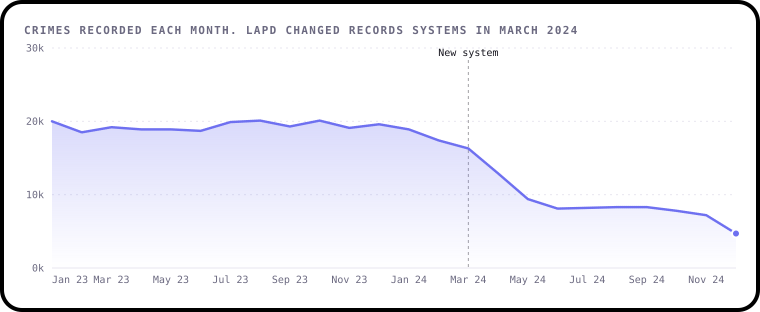
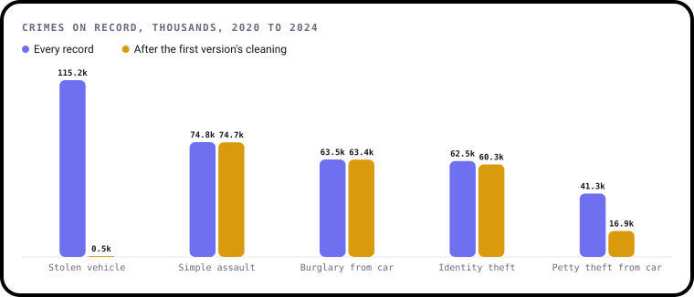
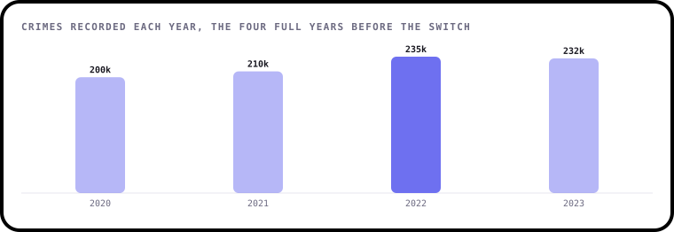
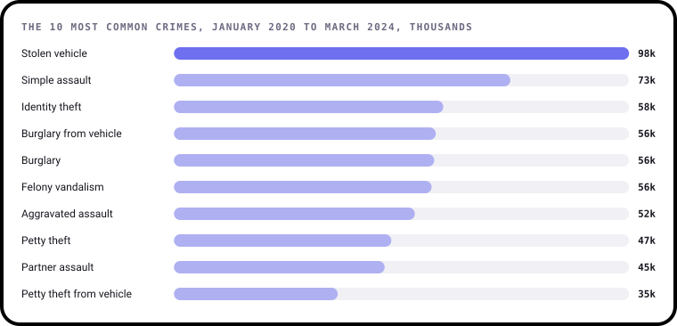
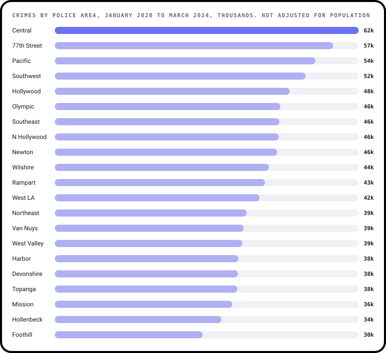
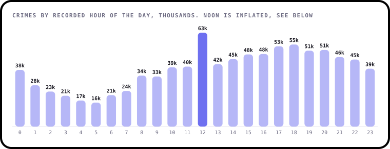
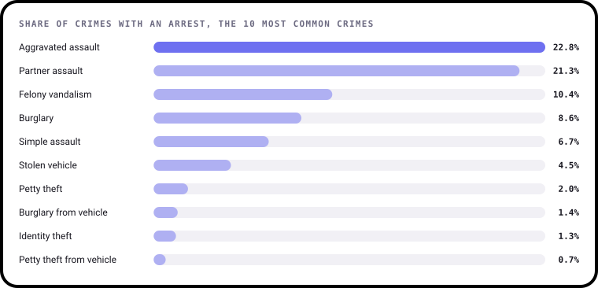
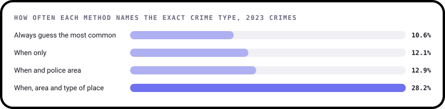

# Findings

What 1,004,894 crime reports from Los Angeles can and can't tell you. This page is written by [`build.py`](build.py), so every
number comes straight from the data.

These are crimes recorded by the Los Angeles Police Department, not all crime. Findings 3 to 7 use the 917,456 crimes from January 2020 to
6 March 2024, the day before LAPD changed records systems.

## 1. The 73% fall that isn't one

Recorded crimes averaged 19,362 a month in 2023 and were 17,394 in February 2024. They were 16,293 in March, 9,386 in May and 4,697 in December, a 73%
drop from February.

On 7 March 2024, LAPD moved to a new records system, and it has since retired this dataset. So this drop can't be read as less crime,
and this data can't show whether crime rose or fell after that date. LAPD now publishes separate datasets from the new system, which
start from that date and use different definitions, so they can't simply be added on to this one.

## 2. Cleaning deleted the most common crime

The first version of this project dropped every row with a blank field, a very common cleaning step. It looked harmless, removing 15.2% of rows, but the
blanks weren't random. Stolen vehicle reports have no victim details, so 99.5% of them vanished: 115,184 became 546, taking the most common crime in the file
down to number 66.

Every other chart here keeps those rows. Blank victim details are only a problem if you're studying victims.

## 3. Recorded crime rose before the switch

Across the four full years, recorded crimes went from 199,847 in 2020 to 235,259 in 2022 and 232,345 in 2023, up 16%. 2020 was the first year of the pandemic, so it's an unusual
starting point.

Stolen vehicles rose 18% and petty theft from vehicles fell 18%. Identity theft stands out, going from 9,040 and 11,373 in 2020 and 2021 to 22,186 in 2022, then back to 13,617. The
data doesn't explain that one-year jump.

## 4. Ten crime types make up most of it

Of 139 crime types on record, the top 10 account for 63%. Stolen vehicles lead with 98,098.

Central has the most crimes of any police area at 62,462, about twice Foothill's 30,364. These are counts, not rates. The data has no population figures, and Central includes
downtown, where many people visit and work, so this doesn't show where a person is most at risk.

## 5. Noon is a recording habit as much as a crime peak

Noon has 62,470 crimes, against 39,924 the hour before and 41,528 the hour after. That spike is suspicious. 39% of all crimes are logged exactly on the hour, when only about
2% would be if times were exact. And 17% of identity thefts are logged at noon, a crime whose victims often can't know when it happened: 29% are reported more than 30 days later.
The first of the month has 46% more crimes than a typical day, which looks like the same habit applied to dates.

Setting noon aside, the pattern is plausible: lowest around 5am with 15,892 crimes, and highest around 6pm with 54,553. Day of the week matters much less, with Friday only 11% above
Tuesday.

## 6. Most crimes never record an arrest

9.4% of crimes show an arrest and 79% are still marked "investigation continuing". Among the 10 most common crimes, arrests range from 22.8% for aggravated assault to 0.7% for petty theft from vehicle. Stolen vehicles sit at
4.5% and identity theft at 1.3%.

Crimes between people are far less likely to stay open: 34% of partner assaults are still marked open, against 98% of identity thefts. This status may not be updated after a report is filed, so treat it as a
minimum and not an official clearance rate.

## 7. Knowing when barely helps predict a crime. Knowing the type of place does

The first version tried to predict the type of crime from the date and scored 10%. It never checked that against guessing, which would have scored 8.8% on its rows. Here, each method
trains on 2020 to 2022 (140,730 crimes from the sample) and is tested on 2023 (50,455 crimes).

Always guessing "stolen vehicle" is right 10.6% of the time. Adding the hour, day and month reaches 12.1%, and the police area 12.9%. Adding the type of place jumps to 28.2%, because a car park and a
home see very different crimes. This is about understanding the data. It isn't a tool for policing decisions, since recorded crime reflects where
crimes get reported and policed as well as where they happen.

## What this data can't tell you

- **Whether crime fell after March 2024.** This dataset can't answer that.
- **All crime.** Many crimes are never reported, and reporting differs between crimes and neighbourhoods.
- **Risk.** There are no population figures, so these counts aren't rates.
- **Why.** The data shows patterns, not causes.

## How it was worked out

1. [`data/prepare.py`](../data/prepare.py) turns the full download into summaries and a 200,000-crime sample, leaving out addresses, coordinates, record numbers and victim descent.
2. [`analysis.py`](analysis.py) holds every calculation as a small, tested function.
3. [`charts.py`](charts.py) draws each chart with [bezel-charts](https://pypi.org/project/bezel-charts/).
4. [`notebooks/crime_data_analysis.ipynb`](../notebooks/crime_data_analysis.ipynb) walks through the same steps with the working shown.

Counts come from every record. Only the model in finding 7 uses the sample.
